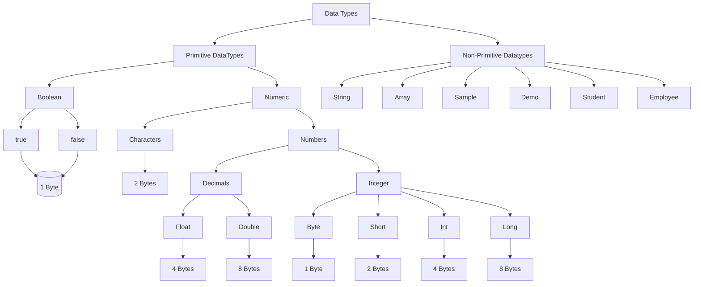

# 📘 Java Basics: Learning Order and Notes

Package: `com.practice.basics.*`  ·  Java 21
Legend: ✅ you already have programs in the repo · 🆕 still to add

---

## 🧭 Learning Order

| #  | Stage                             | Repo package                                   | Status                                    |
|----|-----------------------------------|------------------------------------------------|-------------------------------------------|
| 1  | Setup, first program, comments    | `basics` (Hello, Main)                         | ✅                                         |
| 2  | Variables, data types, output     | `output.print`, `output.store`                 | ✅                                         |
| 3  | Type conversion, wrappers, `Math` | `typeconversion`, `wrappers`                   | ✅ / 🆕                                    |
| 4  | Operators                         | `operators.*`                                  | ✅                                         |
| 5  | User input                        | `input`                                        | 🆕                                        |
| 6  | Decision making (`if`, `switch`)  | `controlflow.ifelse`, `controlflow.switchcase` | ✅                                         |
| 7  | Loops and digit programs          | `controlflow.loops.*`                          | ✅                                         |
| 8  | Methods                           | `methods.*`                                    | ✅ basic, 🆕 overloading/varargs/recursion |
| 9  | Number programs                   | `numberprograms`                               | ✅                                         |
| 10 | Nested loops and print patterns   | `printpatterns.*`                              | ✅                                         |
| 11 | Arrays                            | `arrays`                                       | 🆕                                        |
| 12 | Strings, `StringBuilder`          | `strings`                                      | 🆕                                        |
| 13 | Formatting and regex              | `formatting`, `regex`                          | 🆕                                        |
| 14 | Interview tests, mini projects    | `interviewtests`, `projects`                   | ✅                                         |

**Why this order:** each stage only needs what came before it. Loops need conditions, patterns need nested loops, strings are easier once you know arrays (a `String` is basically a `char[]`), and regex only makes sense once you are comfortable with strings.

**Suggested pace (60-90 min/day):** stages 1-4 in week 1 · 5-7 in weeks 2-3 · 8-10 in week 4 · 11-13 in weeks 5-6 · 14 in week 7.

---

## 1. Setup and First Program

```java
package com.practice.basics;

public class Hello {
    public static void main(String[] args) {
        System.out.println("Hello, Java!");
    }
}
```

- **JDK** compiles and runs, **JRE** only runs, **JVM** executes bytecode. Flow: `.java` → `javac` → `.class` (bytecode) → JVM.
- `main` signature: `public static void main(String[] args)`: public so the JVM can reach it, static so no object is needed, void because nothing is returned.
- File name must match the `public` class name. One public class per file.
- Comments: `// line`, `/* block */`, `/** javadoc */`.
- Java is case-sensitive. Every statement ends with `;`.
- Quick run (Java 11+): `java Hello.java`.

**Checkpoint:** What is the difference between JDK, JRE and JVM? Why is `main` static?

---

## 2. Variables, Data Types, Output

### Primitive types

| Type      | Size        | Range / precision                  | Default    |
|-----------|-------------|------------------------------------|------------|
| `byte`    | 8-bit       | -128 to 127                        | 0          |
| `short`   | 16-bit      | -32,768 to 32,767                  | 0          |
| `int`     | 32-bit      | about ±2.147 billion               | 0          |
| `long`    | 64-bit      | about ±9.2 × 10¹⁸ (use `L` suffix) | 0L         |
| `float`   | 32-bit      | ~7 digits (use `f` suffix)         | 0.0f       |
| `double`  | 64-bit      | ~15-16 digits                      | 0.0        |
| `char`    | 16-bit      | 0 to 65,535 (UTF-16)               | `'\u0000'` |
| `boolean` | JVM-defined | `true` / `false`                   | false      |

- Local variables have **no default value**. You must assign before use. Fields (class-level) get the defaults above.
- Reference types (`String`, arrays, objects) default to `null`.
- `int` is the default for integer literals, `double` for decimals. `long big = 3_000_000_000L;` (underscores allowed).
- `final` makes a variable a constant: `final double PI = 3.14159;` (constants are `UPPER_SNAKE_CASE`).
- `var` (Java 10+) infers a local variable's type: `var count = 10;` (still statically typed, local only).
- Literals: `0b101` binary, `017` octal, `0xFF` hex, `'A'`, `"text"`.



### Naming rules and conventions
- Allowed: letters, digits, `_`, `$`. Cannot start with a digit. Cannot be a keyword.
- Convention: variables and methods `lowerCamelCase`, classes `UpperCamelCase`, constants `UPPER_SNAKE_CASE`, packages `lowercase`.

### Output
```java
System.out.println("with newline");
System.out.print("no newline");
System.out.printf("%s is %d years old%n", name, age);
```

**Common mistakes**
- Using a local variable before initialising it.
- `int x = 3.5;` (compile error: possible lossy conversion).
- `long l = 3000000000;` (compile error: the literal is an `int`, so it needs `L`).

**Checkpoint:** What are the defaults for fields? Is `String` a primitive?

---

## 3. Type Conversion, Wrappers, Math

### Widening (automatic) and narrowing (manual cast)
```
byte → short → int → long → float → double
              char → int
```
```java
int i = 100;
double d = i;          // widening, automatic
double pi = 3.99;
int n = (int) pi;      // narrowing, 3 (truncates, does not round)
char c = (char) 98;    // 'b'
```
- Narrowing can lose data: `(byte) 130` is `-126`.
- In expressions, `byte`/`short`/`char` are promoted to `int` first: `byte a = 1, b = 2; byte c = a + b;` fails, so write `(byte)(a + b)`.
- Integer division truncates: `5 / 2` is `2`, `5 / 2.0` is `2.5`.

### Wrapper classes
| Primitive  | Wrapper      |
|------------|--------------|
| int        | Integer      |
| char       | Character    |
| boolean    | Boolean      |
| double     | Double, etc. |

```java
int n = Integer.parseInt("42");
String s = String.valueOf(42);       // or Integer.toString(42)
Integer boxed = 10;                  // autoboxing
int unboxed = boxed;                 // unboxing
```
- Unboxing a `null` wrapper throws `NullPointerException`.
- **Integer cache gotcha:** `Integer a = 127, b = 127; a == b` is `true`, but `128 == 128` boxed is `false`. Always compare wrappers with `.equals()`.
- Useful constants: `Integer.MAX_VALUE`, `Integer.MIN_VALUE`, `Double.MAX_VALUE`.
- `Character` helpers: `isDigit`, `isLetter`, `isUpperCase`, `toUpperCase`, `getNumericValue`.

### Math class
`Math.abs`, `pow` (returns double), `sqrt`, `max`, `min`, `round`, `floor`, `ceil`, `random()`, `cbrt`, `floorMod`, `addExact` (throws on overflow).

### Overflow and floating-point
- `Integer.MAX_VALUE + 1` silently wraps to `Integer.MIN_VALUE`.
- `0.1 + 0.2 != 0.3` (binary floating point). Use `BigDecimal` for money (covered in the `money` package).

**Checkpoint:** What does `(int) -3.9` give? Why is `Integer a = 200, b = 200; a == b` false?

---

## 4. Operators

| Category              | Operators                 | Notes                                                 |
|-----------------------|---------------------------|-------------------------------------------------------|
| Arithmetic            | `+ - * / %`               | `%` takes the sign of the left operand: `-7 % 3 = -1` |
| Unary                 | `+ - ++ -- !`             | prefix changes first, postfix uses then changes       |
| Relational            | `== != < > <= >=`         | return `boolean`                                      |
| Logical               | `&& \|\| !`               | short-circuit                                         |
| Bitwise               | `& \| ^ ~ << >> >>>`      | work on bits                                          |
| Assignment / compound | `= += -= *= /= %= &= <<=` | compound includes an implicit cast                    |
| Ternary               | `cond ? a : b`            | expression, not statement                             |
| String concat         | `+`                       | left to right                                         |

### Key points
```java
int x = 5;
int a = x++;   // a = 5, x = 6   (post)
int b = ++x;   // x = 7, b = 7   (pre)

byte v = 10;
v += 5;        // OK, implicit cast
// v = v + 5;  // compile error

System.out.println(1 + 2 + "a");  // "3a"
System.out.println("a" + 1 + 2);  // "a12"
System.out.println('a' + 1);      // 98 (int)
System.out.println((char)('a' + 1)); // b
```
- **Short-circuit:** `&&` stops if the left is false, `||` stops if the left is true. `&` and `|` always evaluate both sides.
  `if (obj != null && obj.isReady())` is safe because of short-circuit.
- **Bitwise tricks:**
    - Odd check: `(n & 1) == 1`
    - Multiply by 2: `n << 1` · divide by 2: `n >> 1`
    - Swap without temp: `a ^= b; b ^= a; a ^= b;`
    - `~n == -n - 1`
- `>>` keeps the sign bit, `>>>` fills with zeros.
- `==` on objects compares references. Use `.equals()` for content.
- **Precedence (high → low):** postfix → unary → `* / %` → `+ -` → shifts → relational → `== !=` → `&` → `^` → `|` → `&&` → `||` → ternary → assignment. When in doubt, add parentheses.

**Repo programs:** `LargestOfThreeNumbers`, `SmallestOfThreeNumbers`, `LargestOfFiveNumbers` (ternary), `LogicalAndDemo` and the other logical demos.

**Checkpoint:** What is printed by `int i = 1; System.out.println(i++ + ++i);`? (Answer: 4.)

---

## 5. User Input 🆕

```java
import java.util.Scanner;

try (Scanner sc = new Scanner(System.in)) {
    System.out.print("Enter age: ");
    int age = sc.nextInt();
    sc.nextLine();                 // consume leftover newline
    System.out.print("Enter name: ");
    String name = sc.nextLine();
}
```
- `nextInt()`, `nextDouble()`, `next()` (one word), `nextLine()` (whole line), `hasNextInt()` (validate before reading).
- **Classic bug:** after `nextInt()`, the newline stays in the buffer, so the next `nextLine()` returns an empty string. Fix it by calling an extra `nextLine()`.
- Wrong input type throws `InputMismatchException`. Use `hasNextInt()` or try/catch.
- Don't close a `Scanner` on `System.in` repeatedly (it closes the stream). Create one for the program.
- For fast input in competitive coding use `BufferedReader` + `Integer.parseInt(br.readLine())`.
- `args[]` in `main` holds command-line arguments.

**Practice:** sum of two numbers, simple interest, area of circle, even/odd from input, grade from marks (input-driven versions of your existing programs).

---

## 6. Decision Making

### `if` family
```java
if (marks >= 90) { ... }
else if (marks >= 75) { ... }
else { ... }
```
- Always use braces, even for one-liners.
- The condition must be `boolean`. `if (x = 5)` is a compile error in Java (unlike C).
- Dangling else: an `else` binds to the nearest `if`.
- Ternary replaces simple if-else when assigning a value.

### `switch`
Classic:
```java
switch (day) {
    case 1: name = "Mon"; break;   // forgetting break → fall-through
    case 6: case 7: name = "Weekend"; break;
    default: name = "Unknown";
}
```
Modern (Java 14+), no fall-through, returns a value:
```java
String type = switch (day) {
    case 1, 2, 3, 4, 5 -> "Weekday";
    case 6, 7          -> "Weekend";
    default            -> throw new IllegalArgumentException("Bad day: " + day);
};
```
- `switch` accepts `byte, short, char, int`, their wrappers, `String`, `enum` (and patterns in Java 21).
- Case labels must be compile-time constants and unique.
- Use `yield` to return a value from a block inside a switch expression.
- Switch expressions must be exhaustive (cover all cases or have `default`).

**Repo programs:** `IfElseDemo`, `ElseIfLadderDemo`, `UpperOrLowerCase`, `DayNameFromNumber`, `SeasonName`, `VowelOrNot`, `WeekdayOrWeekend`.

**Checkpoint:** What happens if you forget `break` in an old-style switch? Why can't you `switch` on a `double`?

---

## 7. Loops

### The three loops
```java
for (int i = 1; i <= 5; i++) { ... }       // known number of iterations
while (n > 0) { ... }                       // unknown iterations, check first
do { ... } while (choice != 0);            // runs at least once (menus)
```
- Anatomy of `for`: `init; condition; update`. Each part is optional. `for(;;)` is an infinite loop.
- `break` exits the loop, `continue` skips to the next iteration.
- **Labeled break** exits an outer loop: `outer: for(...) { for(...) { if(x) break outer; } }`.
- Enhanced for: `for (int v : arr) { ... }` (read-only access, no index).
- Off-by-one errors: `<` vs `<=`. Decide the first and last value before writing the condition.

### The digit-extraction pattern (core of most programs)
```java
int n = 4592, sum = 0;
while (n > 0) {
    int digit = n % 10;   // last digit
    sum += digit;
    n /= 10;              // remove last digit
}
```
- Count digits: increment a counter in the loop (or `String.valueOf(n).length()`).
- Reverse a number: `rev = rev * 10 + digit;`
- Largest/smallest digit: keep `max`/`min` and compare each digit.
- Second-largest: track two variables and update carefully.
- Handle negatives with `Math.abs(n)`, and handle `0` explicitly (the loop body never runs for 0).

### Common loop recipes
| Task                      | Idea                                |
|---------------------------|-------------------------------------|
| Sum / product of range    | accumulator starting at 0 / 1       |
| Even / odd numbers        | `i % 2 == 0` or step by 2           |
| Count with condition      | counter + `if` inside               |
| Alphabets                 | `for (char c = 'A'; c <= 'Z'; c++)` |
| nth number meeting a rule | loop until `count == n`             |

**Repo programs:** `forloop`, `whileloop`, `digitprograms`, `DoWhileExample`.

**Checkpoint:** Write the loop that reverses 1234. Which loop type guarantees one execution?

---

## 8. Methods

```java
public static int add(int a, int b) {
    return a + b;
}
```
- Parts: modifier, return type, name, parameters, body. `void` returns nothing.
- `static` methods belong to the class and are called as `ClassName.method()` (or just `method()` inside the same class). Instance methods need an object.
- **Java is always pass-by-value.** For objects, the value is a copy of the reference. You can mutate the object, but you can't re-point the caller's variable.
```java
static void change(int x) { x = 99; }        // caller's value is unaffected
static void mutate(int[] arr) { arr[0] = 99; } // caller sees this change
```
- **Overloading:** same name, different parameter list (type, number or order). The return type alone is not enough. Resolution happens at compile time.
- **Varargs:** `static int sum(int... nums)` (treated as an array, must be the last parameter).
- **Recursion:** needs a base case and progress toward it, otherwise `StackOverflowError`.
```java
static long factorial(int n) { return n <= 1 ? 1 : n * factorial(n - 1); }
```
- Variable **scope:** a variable lives in the block where it is declared. Method parameters and locals are not shared between methods.
- Good methods do one thing, have a verb name (`isPrime`, `reverse`), and return values instead of printing.
- Refactor your loop programs so the logic sits in a method and `main` only calls it. This also makes them testable with JUnit.

**Repo programs:** `StaticMethodWithArguments`, `StaticMethodWithArgumentsAndReturn`, `StaticMethodWithoutArguments`.

**Checkpoint:** Is Java pass-by-reference? Can two methods differ only by return type?

---

## 9. Number Programs

| Program        | Definition                           | Example                      |
|----------------|--------------------------------------|------------------------------|
| Armstrong      | sum of digits^(digit count) = number | 153 = 1³+5³+3³               |
| Strong         | sum of digit factorials = number     | 145 = 1!+4!+5!               |
| Palindrome     | equals its reverse                   | 121                          |
| Prime          | exactly two divisors (1 and itself)  | 7                            |
| Perfect square | `sqrt` is an integer                 | 49                           |
| Spy            | sum of digits = product of digits    | 1124 → 1+1+2+4 = 8 = 1×1×2×4 |
| Perfect        | sum of proper divisors = number      | 6 = 1+2+3                    |
| Fibonacci      | each term = sum of previous two      | 0 1 1 2 3 5 8                |
| Non-Fibonacci  | numbers not in that series           | 4 6 7 9 10 …                 |

### Techniques
- **Prime check:** loop `i` from 2 to `√n`. If `n % i == 0` it's not prime. `n < 2` is never prime.
- **Factorial** overflows `long` after 20!. Use `BigInteger` for larger.
- **Fibonacci:** keep `a`, `b`, then `next = a + b; a = b; b = next;`
- **Perfect square:** `int r = (int) Math.sqrt(n); r * r == n`.
- **Power without `Math.pow`:** multiply in a loop (watch overflow and negative exponents).
- **Swap two numbers:** temp variable (clearest), arithmetic, or XOR.

### Approach for any new problem
1. Write the definition and 2-3 examples by hand.
2. Identify the repeated step (usually digit extraction or a divisor loop).
3. Handle edge cases: `0`, `1`, negatives, overflow.
4. Wrap the logic in a method that returns a boolean or value.
5. Test with a few known inputs.

**Repo programs:** `ArmstrongNumber`, `StrongNumber`, `PalindromeNumber`, `PrimeNumber`, `PerfectSquare`, `Factorial`, `Fibonacci`, `SpyNumber`, `SwapNumbers`, `PowerOfNumber`.

**Checkpoint:** Why do we loop only up to √n in the prime check?

---

## 10. Nested Loops and Print Patterns

**Mental model:** the outer loop controls **rows**, the inner loop(s) control what is printed **in each row**. Print a newline after each inner loop finishes.

```java
for (int row = 1; row <= 5; row++) {
    for (int col = 1; col <= row; col++) {
        System.out.print("* ");
    }
    System.out.println();
}
```
Output:
```
*
* *
* * *
* * * *
* * * * *
```

### Recipe for any pattern
1. Count the **rows** (outer loop range).
2. For each row, find how many **spaces** and how many **symbols**, as a formula of `row`.
3. Find **what** is printed: `*`, the row number, the column number, a running counter, a letter (`(char)('A' + col - 1)`).
4. Check the pattern for row 1 and the last row.

### Common formulas (n rows)
| Shape             | Spaces in row i                                                     | Symbols in row i  |
|-------------------|---------------------------------------------------------------------|-------------------|
| Right triangle    | 0                                                                   | `i`               |
| Inverted triangle | 0                                                                   | `n - i + 1`       |
| Pyramid           | `n - i`                                                             | `2i - 1`          |
| Inverted pyramid  | `i - 1`                                                             | `2(n - i) + 1`    |
| Diamond           | pyramid + inverted pyramid                                          |                   |
| Hollow square     | print only on border (`row==1 \|\| row==n \|\| col==1 \|\| col==n`) |                   |

### Classic patterns to master
Right triangle, inverted triangle, pyramid, diamond, hollow square/triangle, Floyd's triangle (running counter), Pascal's triangle, number triangle (repeat row number), alphabet triangle, butterfly, X shape, number pyramid.

### Tips
- Use `print`, not `println`, inside the inner loop.
- Keep a separate counter outside both loops for sequences that continue across rows.
- Draw the pattern on paper with row/column indices first.
- After solving, rename `Pattern01` to a descriptive name, e.g. `RightTriangleStarPattern`.

**Checkpoint:** What loop bounds produce a pyramid of height 5?

---

## 11. Arrays 🆕

```java
int[] a = new int[5];             // default 0s
int[] b = {3, 1, 4, 1, 5};
int[][] grid = new int[3][4];     // 3 rows, 4 columns
int[][] jagged = new int[3][];    // rows can have different lengths
```
- Fixed size. `arr.length` is a field (no parentheses). Strings use `length()`.
- Index range `0 … length-1`. Out of range throws `ArrayIndexOutOfBoundsException`.
- Arrays are objects. Assigning `int[] c = b;` copies the **reference**, not the data. Use `Arrays.copyOf(b, b.length)` or `b.clone()`.
- `==` compares references. Use `Arrays.equals(x, y)` (or `deepEquals` for 2D).
- Printing: `Arrays.toString(arr)`, `Arrays.deepToString(grid)`. `System.out.println(arr)` prints a useless hash.

### `Arrays` utility
`sort`, `fill`, `copyOf`, `copyOfRange`, `equals`, `binarySearch` (array must be sorted), `asList`, `stream`.

### Core programs to write
| Group     | Programs                                                                    |
|-----------|-----------------------------------------------------------------------------|
| Basics    | sum, average, min/max, second largest, count even/odd                       |
| Search    | linear search, binary search                                                |
| Transform | reverse, rotate left/right by k, remove duplicates, merge two sorted arrays |
| Sorting   | bubble, selection, insertion (before using `Arrays.sort`)                   |
| Checks    | palindrome array, sorted check, find missing number, find duplicates        |
| 2D        | matrix addition, multiplication, transpose, diagonal sum, spiral print      |

**Checkpoint:** Why does `int[] c = b; c[0] = 9;` change `b[0]` too?

---

## 12. Strings and StringBuilder 🆕

### Immutability and the pool
```java
String s1 = "java";
String s2 = "java";
String s3 = new String("java");
s1 == s2;          // true  (same pool object)
s1 == s3;          // false (new heap object)
s1.equals(s3);     // true  (content)
s3.intern() == s1; // true
```
- Strings never change. Every "modification" returns a new `String`. Hence `s.toUpperCase();` alone does nothing, you must assign it.
- Always compare with `equals` / `equalsIgnoreCase`, never `==`.
- Put the literal first to avoid NPE: `"yes".equals(input)`.

### Essential methods
| Purpose   | Methods                                                                      |
|-----------|------------------------------------------------------------------------------|
| Info      | `length()`, `isEmpty()`, `isBlank()`, `charAt(i)`                            |
| Search    | `indexOf`, `lastIndexOf`, `contains`, `startsWith`, `endsWith`               |
| Extract   | `substring(begin, endExclusive)`, `split(regex)`, `toCharArray()`            |
| Compare   | `equals`, `equalsIgnoreCase`, `compareTo`                                    |
| Transform | `toUpperCase`, `toLowerCase`, `trim`, `strip`, `replace`, `repeat`, `concat` |
| Build     | `String.join(",", list)`, `String.valueOf(x)`, `String.format`               |

### StringBuilder
```java
StringBuilder sb = new StringBuilder();
for (...) sb.append(x);          // O(n) total, vs O(n²) with += in a loop
sb.reverse(); sb.insert(0, "x"); sb.deleteCharAt(sb.length() - 1); sb.setCharAt(0, 'Z');
String result = sb.toString();
```
- `StringBuilder` is mutable and not thread-safe. `StringBuffer` is the synchronized older version.
- Use it whenever you build a string in a loop.

### Core programs to write
Reverse a string, palindrome, count vowels/consonants, character frequency, anagram check, remove duplicates, first non-repeating character, capitalise each word, count words, remove spaces, longest word, check pangram, string compression (`aaabb` → `a3b2`), Caesar cipher.

**Checkpoint:** How many `String` objects does `new String("a")` create? Why is `+=` in a loop slow?

---

## 13. Formatting and Regex 🆕

### `printf` / `String.format`
| Specifier     | Meaning                             | Example                                           |
|---------------|-------------------------------------|---------------------------------------------------|
| `%d`          | integer                             | `%5d` width 5, `%-5d` left-align, `%05d` zero-pad |
| `%,d`         | thousands separator                 | `1,234,567`                                       |
| `%f` / `%.2f` | decimal / 2 places                  | `3.14`                                            |
| `%s`          | string                              | `%-10s` left-aligned column                       |
| `%c`          | char                                |                                                   |
| `%b`          | boolean                             |                                                   |
| `%x`          | hex                                 |                                                   |
| `%n`          | portable newline (prefer over `\n`) |                                                   |

```java
System.out.printf("%-10s %5d %8.2f%n", "Pen", 3, 12.5);
```

### Regex
```java
import java.util.regex.*;

Pattern p = Pattern.compile("\\d{3}-\\d{4}");
Matcher m = p.matcher("Call 555-1234 now");
if (m.find()) System.out.println(m.group());   // 555-1234

"abc123".matches("[a-z]+\\d+");                 // true (whole string)
"a1b2".replaceAll("\\d", "#");                  // a#b#
```
| Token                | Meaning                        |
|----------------------|--------------------------------|
| `.`                  | any char                       |
| `\d \w \s`           | digit / word char / whitespace |
| `* + ?`              | 0+ / 1+ / 0 or 1               |
| `{n,m}`              | between n and m times          |
| `[abc] [^abc] [a-z]` | set / negated set / range      |
| `^ $`                | start / end                    |
| `( )`                | group (`m.group(1)`)           |
| `\|`                 | alternation                    |

- In Java strings, escape backslashes: `"\\d"`.
- `matches()` tests the **whole** string, `find()` searches within it.
- Precompile a `Pattern` if you use it repeatedly.

**Practice:** validate email, phone, PIN code, password strength, extract all numbers from text, mask a card number.

---

## 14. Interview Tests and Mini Projects

- `interviewtests`: rename `Task11`, `Task12`, `Task22 … Task26` after you read what each solves. Re-solve them without looking.
- **Mini projects:**
    - `ATMOperations` → `AtmApp`: balance, deposit, withdraw, PIN, `do-while` menu, input validation.
    - `ShoppingMall` → `ShoppingMallApp`: items, cart, bill with `printf`, discounts, methods per feature.
- Refactor each into small methods. Replace magic numbers with `final` constants. Add a README per project (what it does, how to run, sample output, what you learned).

---

## ⚠️ Top 15 Beginner Mistakes

1. Using `==` to compare strings or wrappers.
2. Integer division where a decimal was expected (`5 / 2`).
3. Off-by-one in loop bounds and array indices.
4. Forgetting `break` in an old-style `switch`.
5. `Scanner.nextInt()` followed by `nextLine()` (leftover newline).
6. Using a local variable before assigning it.
7. Assuming `s.toUpperCase()` changes `s`.
8. `=` instead of `==` in a condition (compile error with ints, silent bug with booleans).
9. Integer overflow (`int` factorials past 12!).
10. Forgetting that `Math.pow` returns `double`.
11. Putting a semicolon after `for(...)` or `if(...)`.
12. Re-initialising an accumulator inside the loop.
13. Modifying the loop variable inside a `for`.
14. Catching nothing around user input that can be invalid.
15. Printing inside every method instead of returning values.

---

## 🧠 Quick Revision Sheet

- 8 primitives · `int` default for integers, `double` for decimals · `L` and `f` suffixes
- Widening is automatic, narrowing needs a cast and may lose data · small types promote to `int`
- `&&`/`||` short-circuit · `%` keeps the left sign · `++x` vs `x++`
- Digit loop: `n % 10` and `n /= 10`
- `switch` arrow form has no fall-through and returns a value
- Java is pass-by-value · overloading is by parameters, not return type
- Arrays: fixed size, zero-indexed, reference type · `Arrays.toString` to print
- `String` immutable, pool, `equals` for content · `StringBuilder` for loops
- `printf`: `%d %s %.2f %n` · regex: `matches` (whole) vs `find` (partial)

## ✅ Completion Checklist

- [ ] Can explain every checkpoint question out loud
- [ ] Solved each program group without looking at solutions
- [ ] Refactored loop programs into methods that return values
- [ ] Added JUnit tests for `isPrime`, `factorial`, `isPalindrome`, `isSpy`, `reverseString`
- [ ] Wrote notes in own words for each stage
- [ ] Finished both mini projects with READMEs
- [ ] Committed after every stage (`basics: add arrays exercises`)